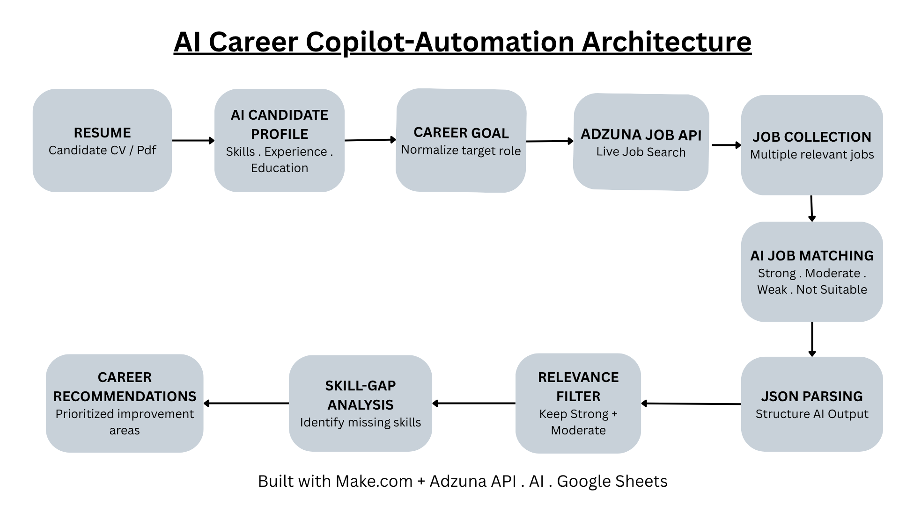
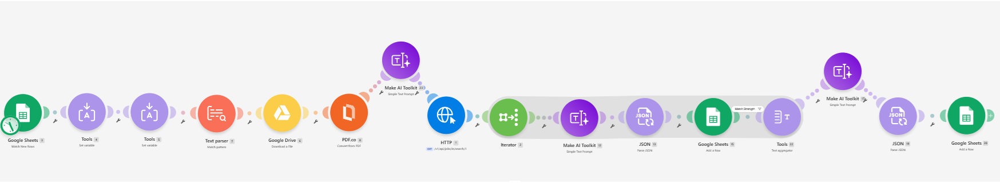
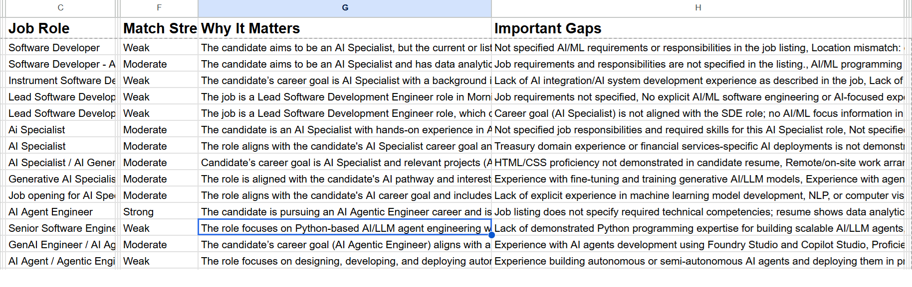
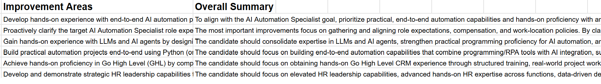

# AI Career Copilot

An AI-powered career automation workflow that analyzes a candidate profile, searches live job listings, evaluates job fit, identifies skill gaps, and generates personalized career recommendations.

## Problem

Job seekers often have to manually:

- Understand their own skills and experience
- Search through multiple job listings
- Compare job requirements with their profile
- Identify missing skills
- Decide what skills to improve next

This project automates that process using AI, APIs, and workflow automation.

## Solution

The AI Career Copilot takes a candidate's resume and career goal, searches live job listings, evaluates each opportunity against the candidate profile, and consolidates the most important skill gaps into actionable career recommendations.

## Architecture

## Workflow

1. **Resume → Candidate Profile**
   - Candidate information is processed into a structured profile containing skills, experience, and education.

2. **Career Goal Normalization**
   - AI converts the candidate's career goal into a standardized job-search term.

3. **Live Job Search**
   - The normalized career goal is used to search live job listings through the Adzuna API.

4. **Job Collection**
   - Multiple relevant job listings are collected for analysis.

5. **AI Job Matching**
   - Each job is evaluated against the candidate profile.
   - Jobs are classified as:
     - Strong
     - Moderate
     - Weak
     - Not Suitable

6. **JSON Parsing**
   - AI-generated results are structured into usable fields.

7. **Relevance Filtering**
   - Strong and Moderate matches are passed into the skill-gap analysis.

8. **Skill-Gap Analysis**
   - The workflow identifies recurring skills and experience gaps across relevant job opportunities.

9. **Career Recommendations**
   - AI consolidates the gaps into prioritized improvement areas and an overall career summary.

## Technologies Used

- Make.com
- Make AI Toolkit
- Adzuna Jobs API
- Google Sheets
- JSON parsing
- Iterators
- Filters
- Text Aggregators
- AI prompt-based classification

## Key Automation Features

- Live job search through an external API
- AI-based career-goal normalization
- Automated job matching
- Structured AI output using JSON
- Relevance filtering
- Consolidation of recurring skill gaps
- Personalized career recommendations

## Example Output

The workflow produces:

- Job title and job details
- Match strength
- Reasons for the match
- Important skill gaps
- Consolidated improvement areas
- Overall career recommendations

## Skills Demonstrated

This project demonstrates practical experience with:

- Workflow automation
- API integration
- AI prompt design
- JSON data handling
- Iteration and filtering
- Data aggregation
- AI-based classification
- Multi-step automation architecture
- Debugging and workflow optimization

## Project Outcome

## Screenshots

### 1. Automation Workflow

### 2. Job Matching Results

### 3. Final Career Recommendations

The final workflow transforms a resume and career goal into a structured analysis of relevant job opportunities and the skills the candidate should prioritize developing.
